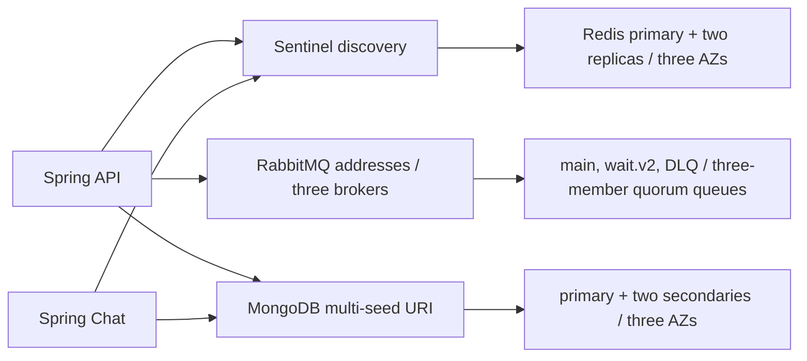

# 독토리 데이터 계층 HA 설계

작성일: 2026-11-15. 상태: **AI가 작성한 로컬 구현·설계 초안, 미배포**.

2026-11-17 갱신: 사용자 요청으로 [로컬 구성과 EC2 IaC 준비](data-ha-configuration-2026-11-17.md)를 진행했다. 이 문서의 최초 제약·버전·미실행 기록은 역사 기록이며 현재 결과는 새 문서를 우선한다. 로컬 기본 통신은 확인했으나 클라우드 배포·장애·복원 검증은 하지 않았다.

사용자 결정은 Redis·RabbitMQ·MongoDB HA를 우선하고 기존 EC2에서 직접 구성·검증하는 것이다. 이번 요청은 코드와 문서 작성까지다. AWS 변경, 원격 push, 실제 서비스 기동과 장애 주입은 수행하지 않는다. 프론트 Kubernetes 편입과 AI 확장·가용성은 후속 범위다.

기준 커밋은 cloud `88b501ec3835aff32a7e8a8913449b9a3a357fc9`, backend `45393d6591c696686a9207e4e1bcd7ebbf263ade`다. 코드 선언을 확인한 것이며 현재 EC2·Terraform state·SSM 값·실행 중인 큐 토폴로지는 조회하지 않았다.

## 1. 해결할 문제와 목표

단일 데이터 노드가 종료되면 인증 상태, 채팅 전달·조회, 알림 전달이 영향을 받을 수 있다. 실제 장애 전파의 범위는 실험으로 확인한다. HA는 복제본을 만들고 다른 노드로 연결을 전환하는 구성과, 장애 중인 요청의 처리 규칙을 함께 포함한다.

| 서비스 | 기준 코드 | 설계 목표 | 데이터 보장의 경계 |
| --- | --- | --- | --- |
| Redis | 단일 노드 기본값, 선택 가능한 Sentinel 부트스트랩 | 3 AZ에 primary 1 + replica 2, Sentinel 3개·quorum 2, Sentinel 지원 클라이언트 | 비동기 복제이므로 ACK한 쓰기도 유실될 수 있다. 토큰·캐시·Pub/Sub를 나눠 요구사항을 정한다. |
| RabbitMQ | 단일 노드 기본값, main/DLQ는 quorum 선언, wait는 classic | 3 AZ의 브로커 3개, main/wait/DLQ 각각 3-member quorum queue, 연결 주소 목록 | confirm·ACK 사이 재전달은 가능하다. SSE/FCM 외부 효과의 exactly-once를 보장하지 않는다. |
| MongoDB | 단일 EC2, 단일 호스트 URI | 3 AZ의 data-bearing replica set(P-S-S), keyfile 인증, multi-seed URI | 정상 과반·저널 조건에서 majority ACK한 쓰기를 기준으로 검증한다. 타임아웃은 미실행을 뜻하지 않는다. |

실험용 가설은 **단일 데이터 노드 종료 후 60초 이내 사용자 행동 재개**다. 이 수치는 제안이며 합의된 SLO나 측정 결과가 아니다. 실제 RTO·RPO, 비용 한도와 허용 중단 시간은 배포 전 정한다. AZ 하나를 잃을 때도 각 서비스에 두 노드가 남도록 배치하지만, 로컬 컨테이너 실험만으로 AZ 장애 내성을 판정하지 않는다.

## 2. 목표 구조

데이터 서비스는 EC2에 둔다. 기존 애플리케이션 K8s 이동과 결합하지 않아 전환 원인을 구분한다. 데이터 레이어는 base 출력을 읽고 app에 필요한 SSM·DNS 정보를 제공한다. base 신규 output이나 역방향 remote-state 의존성은 추가하지 않는다.

각 노드에 현재 선언과 같은 `t4g.micro`, gp3 20 GiB를 유지하면 데이터 노드는 3→9대, 루트 볼륨은 총 60→180 GiB다. 이는 용량 산술이며 적정 사양이나 비용 견적이 아니다. AZ 간 복제 트래픽, CPU credit, 메모리, 디스크 I/O와 운영 비용을 실측해 결정한다. 세 서비스를 한 EC2에 합쳐 같은 실패 영역을 공유하지 않는다.

## 3. 변경 구성과 활성화

### 독립적인 서비스 선택

`terraform/environments/prod/data/variables.tf`에 `enable_redis_ha`, `enable_rabbitmq_ha`, `enable_mongodb_ha`를 추가했다. 모두 기본값은 false다. 기존 `enable_data_ha`는 Redis/RabbitMQ에만 적용하는 호환 입력으로 남긴다. MongoDB가 뜻하지 않게 함께 전환되지 않게 했다.

`ha.tfvars.example`은 예시이며 자동으로 로드되는 `.auto.tfvars`가 아니다. 서비스 하나씩 검증하고 다음으로 넘어간다. 예시의 전체 true 값을 기존 운영에 한 번에 적용하지 않는다.

토폴로지 계산은 provider 없는 `terraform/modules/data-topology`로 분리했다. 실제 리소스 생성은 기존 data root와 compute 모듈이 계속 맡는다. 기존 primary의 `redis`, `rabbitmq`, `mongodb` 키는 그대로 유지하고 `_c`, `_b` peer만 추가한다.

### 기존 state와 디스크 보존

- 기존 single-node state에서는 primary 주소가 유지된다. 이것만으로 교체가 없다고 확정할 수 없고 AMI·SG·다른 설정 drift를 실제 plan과 대조해야 한다.
- 이전 코드에서 이미 HA를 켰다면 `redis_a`, `rabbitmq_a` 주소가 존재할 수 있다. 그 경우 새 기본 키로의 주소 매핑과 관련 SG·DNS 주소를 먼저 검토한다. 알 수 없는 state를 대상으로 자동 state 이동을 실행하지 않는다.
- `scripts/data-ha/check-plan.py`는 이미 내보낸 plan JSON만 읽어 `module.data_compute` 하위의 delete/replace를 거절한다. 다른 레이어의 삭제를 허용하는 검증기가 아니므로 전체 plan 리뷰는 별도로 필요하다.
- 현재 compute 모듈은 `user_data_replace_on_change=false`다. 템플릿을 바꿔도 기존 노드에서 설정 스크립트가 다시 실행되지 않는다. 첫 전환에는 기존 데이터·사용자를 보존하며 설정을 반영하는 별도 운영 단계가 필요하다.
- 데이터는 기존 루트 EBS를 사용한다. HA를 백업이나 볼륨 교체 절차로 대체하지 않는다. 백업과 별도 위치 복원 검증이 선행되어야 한다.

## 4. Redis

`redis-a`와 `redis-c`, `redis-b`를 서로 다른 DB 서브넷에 배치하고 각 노드에서 Sentinel을 실행한다. 데이터 포트 6379와 Sentinel 포트 26379는 앱 서브넷·peer SG에만 연다. Sentinel에 Redis DNS 이름을 사용할 수 있도록 `resolve-hostnames yes`를 명시했다.

기존 `redis.<zone>` CNAME은 a 노드의 별칭이지 자동으로 따라다니는 primary 주소가 아니다. HA 클라이언트는 SSM의 `SPRING_REDIS_SENTINEL_MASTER`, `SPRING_REDIS_SENTINEL_NODES`와 `redis-sentinel` 프로필을 사용해야 한다. API와 Chat 모두 적용 대상으로 삼는다.

교체 노드는 Sentinel 두 개가 같은 값으로 알려 주고 Redis PING이 성공하는 primary를 먼저 찾는다. 기존의 a=primary 정적 역할로 빈 노드를 새 writer로 만들지 않는다. 최초 구성에만 `allow_redis_initial_primary=true`를 사용하고, 3 Sentinel/복제가 성립하면 false로 되돌린다. false 상태에서 primary 발견에 실패하면 bootstrap은 실패한다. 이를 임의로 true로 바꾸는 것을 복구 절차로 사용하지 않는다.

HA 모드에서는 `min-replicas-to-write 1`, `min-replicas-max-lag 5`를 설정한다. 복제 연결이 없는 writer의 쓰기를 제한하는 대신 초기 동기화나 복제 장애 동안 쓰기가 거절될 수 있다. 이 설정도 RPO=0 보장은 아니다. Pub/Sub는 끊긴 구독자에게 자동 재생되지 않으므로, MongoDB에 저장된 메시지 조회 등 별도 보충 경로를 검증한다.

## 5. RabbitMQ

브로커 3개가 클러스터에 속하는 것과 각 큐의 복제본이 3개인 것은 별개다. 기존 큐는 새 노드를 추가해도 복제본이 자동으로 늘었다고 가정하지 않는다.

1. 기존 브로커 a의 데이터·Erlang cookie·노드 이름을 보존한다. 새 c/b 노드만 빈 상태에서 기존 클러스터에 가입시킨다. 기존 큐가 있는 노드에 bootstrap의 reset/join 구간을 재실행하지 않는다.
2. 백엔드에서 classic wait 큐를 새 `notification.delivery.wait.v2` quorum 큐로 분리한다. main/DLQ 기존 이름과 인자 선언은 유지한다. 기존 classic wait 큐를 지우거나 같은 이름으로 타입을 바꾸지 않는다.
3. 기존 wait 큐의 TTL 메시지는 main으로 이동할 때까지 남긴다. 신규 wait.v2는 quorum·at-least-once DLX·reject-publish로 선언한다.
4. `scripts/data-ha/configure-rabbitmq-quorum.sh --configure`는 이후 운영자가 브로커 노드에서 사용하는 도구다. 3 running node와 예상 큐 타입을 확인하고 기존 main/wait.v2/DLQ의 membership을 grow한다. 기존 main의 DLX 보장은 불변 큐 인자 변경 대신 policy로 설정한다. 출력된 각 큐의 3 online member를 확인해야 한다.
5. RabbitMQ 3.13에서 at-least-once DLX에 필요한 feature flag와 정책 적용 상태를 확인한다. 기존 정책 우선순위와 quorum queue 초기 크기도 런타임에서 확인한다.

API의 `rabbitmq-ha` 프로필은 SSM의 `SPRING_RABBITMQ_ADDRESSES`를 명시적으로 바인딩한다. DNS round-robin만으로 클라이언트 failover 완료를 주장하지 않는다.

### ACK와 재시도

기존 코드는 배달 실패 시 원본을 ACK한 후 wait/DLQ로 발행했다. 이번 초안은 `ConfirmedNotificationPublisher`에서 bounded confirm과 unroutable return을 확인하고, 대상 큐 인계가 성공한 뒤 원본을 ACK한다. confirm timeout/NACK/return이면 원본을 ACK하지 않고 requeue한다. ACK 자체의 예외를 배달 예외로 처리해 즉시 재발행하지 않도록 분리했다.

confirm 응답이 끊기면 새 큐에도 메시지가 있고 원본도 재전달될 수 있다. SSE/FCM 중복 전달을 모두 제거한 구현은 아니다. 초기 발행은 기존 DB `afterCommit` 경로에 남아 있으며, confirm 실패를 드러내지만 DB commit과 MQ 발행 사이의 원자성은 없다. 완전한 알림 유실 방지에는 outbox 등 별도 작업이 필요하다. requeue 반복·백로그·publisher confirm 지연을 관측하고 디스크 제한과 복구 정책을 정한다.

## 6. MongoDB

P-S-S 3개를 각 AZ에 두며 arbiter로 데이터 복제본을 대체하지 않는다. 기존 `mongodb` primary 주소는 보존하고 `mongodb-c`, `mongodb-b` DNS·peer SG 규칙을 추가했다.

- 공유 keyfile은 새 SSM SecureString `MONGO_REPLICA_KEY`로 관리한다. `ephemeral random_password`와 `value_wo`를 사용하며 AMI나 Terraform output에 노출하지 않는다. key rotation은 별도 절차다.
- 모든 노드에 동일 replica set 이름과 keyfile을 구성한다. 새로운 빈 클러스터에서 coordinator 0은 먼저 자신으로 set을 초기화하고 사용자·인덱스를 만든 뒤 두 peer를 추가한다. 세 멤버가 PRIMARY/SECONDARY 상태가 된 뒤 기본 write concern을 majority로 설정한다.
- follower는 사용자·인덱스를 독립 생성하지 않고 복제받는다. coordinator에만 사용자·멤버 변경 권한을 사용한다. bootstrap을 현재 secondary에 강제로 재실행하거나 `force` reconfig하지 않는다.
- **기존 standalone 전환은 별도 절차다.** 기존 admin에 `clusterManager` 역할이 없으면 standalone 상태에서 권한 있는 계정으로 먼저 부여해야 한다. keyfile·replication 설정은 인증을 유지하며 반영한다. standalone→replica set 설정 시 재시작이 필요할 수 있으며 무중단 전환으로 표시하지 않는다.
- SSM `MONGO_URI`는 모든 seed, `replicaSet`, `w=majority`, `journal=true`, `retryWrites=true`, bounded `wtimeoutMS`/server selection timeout을 포함한다. API/Chat에서 실제 바인딩과 primary 전환 후 재연결을 확인한다.

애플리케이션의 `clientMessageId`와 unique index 기반 중복 처리도 유지한다. majority ACK 집합을 장애 후 조회해 비교하며, timeout으로 결과가 불명확한 쓰기는 별도 집합에 둔다. MongoDB 손실이 없는 것과 실시간 채팅 broadcast가 누락되지 않는 것은 별도의 기준이다.

## 7. 전환·복구 순서

이 절은 향후 실행 계획이며 이번에 실행한 명령 목록이 아니다.

1. 실습/대상 계정·리전·state·AMI 실제 버전·백업 복원·비용·RTO/RPO를 확인한다. 기존 노드 ID, 볼륨, DNS, 사용자, 큐 타입·member 수를 기록한다.
2. Redis만 활성화한 plan을 리뷰하고 data-resource delete/replace가 없는지 검사한다. 첫 구성과 기존 노드 설정 반영을 구분한다. replica 동기화와 Sentinel 합의를 확인한 뒤 API/Chat 프로필을 단계적으로 전환한다.
3. 단일 Redis 노드 종료/재시작/복제 재합류와 앱 재연결을 검증한다. 정상화 후 `allow_redis_initial_primary=false`로 닫는다.
4. RabbitMQ 새 peer 가입 → wait.v2 선언 → 기존 큐 membership 확장·DLX policy → 주소 목록 클라이언트 전환 → leader 장애/재전달 검증 순서로 진행한다. old wait drain과 남은 메시지를 확인한다.
5. MongoDB는 백업 복원/재시작 영향 검토 → 기존 admin 역할·keyfile → set 초기화·peer sync → URI 전환 → primary 장애·majority ACK 데이터 검증 순서로 진행한다.
6. 마지막에 각 AZ를 잃는 시나리오를 별도 실습 환경에서 검증한다. 두 노드를 잃는 실험은 쓰기 중단·과반 복구를 검증하는 항목으로 구분한다.

서버 전환 전에는 기존 앱 설정으로 되돌릴 수 있지만, primary 전환과 새 쓰기 이후에는 과거 a 노드의 주소로 단순 복귀하지 않는다. 현재 primary와 데이터 기준점을 확인한다. Mongo replica set이나 quorum queue를 단일 노드 모드로 되돌리는 작업도 재검증 없이 HA 플래그를 false로 바꾸는 방식으로 수행하지 않는다. 서비스 정상화와 old member 제거는 분리한다.

K8s 프로필 예시는 `k8s/patches/data-ha/`에 별도로 두었다. ArgoCD가 읽는 기존 `k8s/manifests/workloads`는 자동 변경하지 않았다. 향후 실제 전환에서는 원하는 프로필을 Git 선언에도 함께 반영해야 하며, 수동 patch만 적용하면 ArgoCD self-heal이 되돌릴 수 있다. 그 시점에는 Redis/RabbitMQ의 단계별 프로필을 조합한다. AI 등 다른 Redis 클라이언트가 있으면 함께 조사한다.

## 8. 검증 기준과 결과 구분

| 항목 | 증거·성공 기준 | 이번 상태 |
| --- | --- | --- |
| 토폴로지 | default/각 HA/all/legacy 6조합, stable primary 키, 3 AZ, Mongo majority 옵션 | 순수 Terraform test 실행 |
| 구성·템플릿 | data root validate, 실제 렌더링한 Bash 문법, Mongo JS 구문 | 검증 결과 문서 참조 |
| 잘못된 plan | peer 추가 허용, primary 교체/축소/불명확한 형식 거절 | Python 단위 검사 실행 |
| MQ 인계 | confirm ACK/NACK/return/timeout, confirm 전 원본 ACK 금지, DLQ 실패 requeue | Java 단위 검사 실행 |
| Redis failover | primary 역할/복제 offset/Sentinel 이벤트/앱 성공률·지연·누락 ID | 미실행 |
| MQ failover | 큐별 3 online member, confirm된 비만료 메시지 ID 대조, 중복 횟수·외부 부작용 | 미실행 |
| Mongo failover | rs 상태·복제 지연, majority ACK 집합 유지, timeout 결과 구분, 앱 재연결 | 미실행 |
| 장애 복원 | 원래 노드 복귀 후 동기화, 실제 백업의 별도 복원 | 미실행 |

복구 시간은 장애 주입 시각부터 대상 사용자 행동이 10회 연속 성공하기까지로 기록한다. Redis 인증/채팅, MQ 알림, MongoDB 메시지 저장·조회는 각각 측정한다. 의도적인 TTL 만료, 명시적 거절, confirm/ACK가 불명확한 요청을 유실 집계와 섞지 않는다.

전체 인프라 가용성은 이번 범위만으로 판정하지 않는다. 예를 들어 기준 코드의 RDS Proxy는 RDS 엔진 복제를 대체하지 않으며 RDS Multi-AZ·모니터링 자체의 가용성은 별도 검토 대상이다.

## 9. 근거

- [기준 data 변수와 선언](https://github.com/SuperSon7/doktori-cloud/tree/88b501ec3835aff32a7e8a8913449b9a3a357fc9/terraform/environments/prod/data), [기준 API/Chat 코드](https://github.com/SuperSon7/doktori-backend/tree/45393d6591c696686a9207e4e1bcd7ebbf263ade).
- [Redis Sentinel: Example 2, client discovery, asynchronous replication](https://redis.io/docs/latest/operate/oss_and_stack/management/sentinel/), [Pub/Sub delivery semantics](https://redis.io/docs/latest/develop/pubsub/).
- [RabbitMQ 3.13: quorum replica management, confirms, at-least-once DLX](https://www.rabbitmq.com/docs/3.13/quorum-queues), [Spring AMQP: correlated confirms/returns](https://docs.spring.io/spring-amqp/reference/amqp/template.html).
- [MongoDB 7.0: three data-bearing members](https://www.mongodb.com/docs/v7.0/core/replica-set-architecture-three-members/), [standalone→replica set](https://www.mongodb.com/docs/v7.0/tutorial/convert-standalone-to-replica-set/), [write concern](https://www.mongodb.com/docs/manual/core/replica-set-write-concern/).

Packer 입력은 Redis 7.2, RabbitMQ 3.13/Erlang 26, MongoDB 7.0을 가리킨다. 실제 설치된 patch·지원 상태·AMI 내용은 미확인이다. 이번 변경은 패키지 저장소·설치 버전을 바꾸거나 새 AMI를 빌드하지 않는다.
